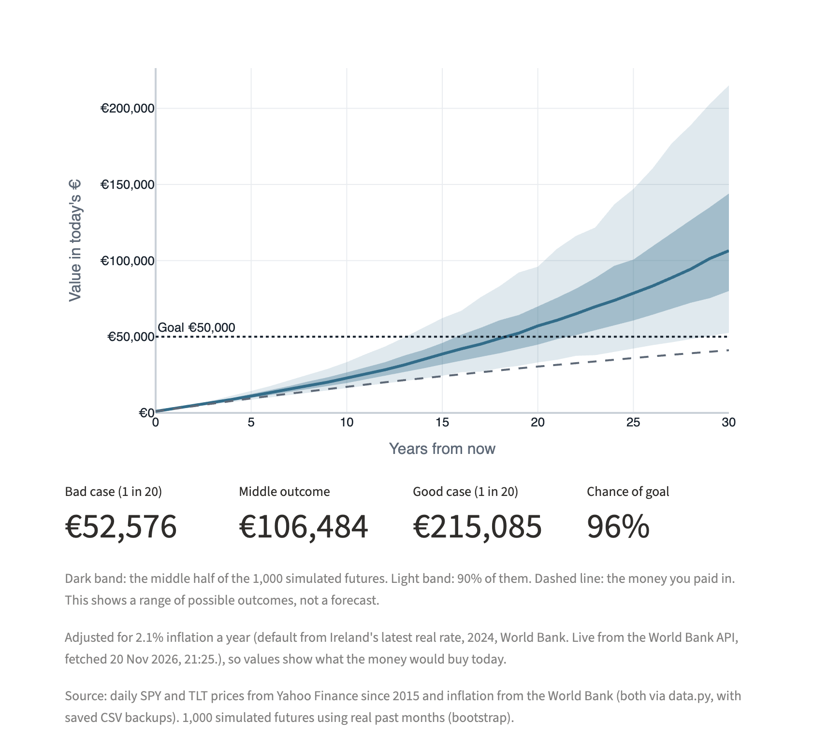

# User Manual
## 1. Getting started
TODO: how to open the dashboard
## 2. Choosing a scenario
TODO: what the scenario switch does
## 3. Panel 1: The global shock
TODO
## 4. Panel 2: Who wins when rates move?
TODO
## 5. Panel 3: Build the best portfolio
TODO
## 6. Panel 4: What could it become?
Shows what someone saving every month could end up with, across 1,000 simulated futures, in today's euros.

**Controls**
- **Monthly (€), Years, Starting amount:** how much you save, for how long, and what you start with.
- **Inflation:** starts at the chosen scenario's rate, or Ireland's latest rate from the World Bank. Drag it to try your own.
- **Savings goal:** a target in today's euros. Set it to 0 to switch it off.
- **Risk quiz:** three questions that pick a mix of shares (SPY) and bonds (TLT): Cautious 30/70, Balanced 60/40 or Adventurous 90/10.
- **Use returns from:** your quiz mix, or the optimal portfolio from Panel 3 (if Panel 3 has built one).
- **Simulation method:** *Real past months (bootstrap)* re-uses real months since 2015 in a random order; *Bell curve* draws returns from a normal distribution with the same average and volatility.

**How to read the chart**
- **Dark band:** the middle half of the 1,000 futures. **Light band:** 90% of them.
- **Solid line:** the middle outcome. **Dashed line:** the money you paid in, in today's euros. **Dotted line:** your goal.
- Hover over any year to see all the values.
- **The four numbers underneath:** bad case (only 1 in 20 futures did worse), middle outcome, good case (only 1 in 20 did better), and the chance of reaching your goal.

**Download my projection (CSV):** saves a year-by-year table of the money paid in and the bad, middle and good outcomes.

All values are a range of possible outcomes, not a forecast.
## 7. When something goes wrong
TODO: messages users might see and what they mean