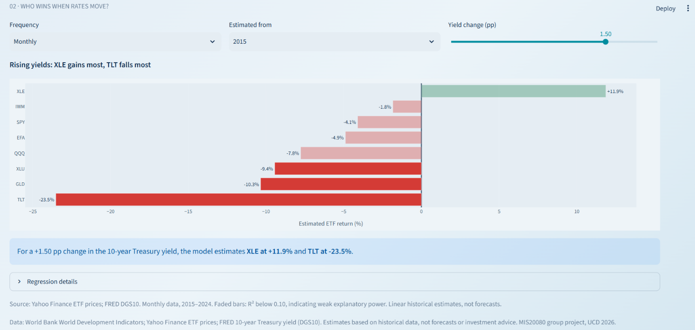

# User Manual
## 1. Getting started

Rates, Risk & Returns is an interactive financial dashboard that explores the relationship between economic conditions, interest rates, investment portfolios and future savings.

**Requirements:** Python 3.11 or newer and the Python packages listed in `requirements.txt`.

**Opening the dashboard locally**

1. Download or clone the project repository from GitHub.
2. Open a terminal in the project folder.
3. Install the required packages:

   `pip install -r requirements.txt`

4. Launch the dashboard:

   `streamlit run app.py`

5. The dashboard should open automatically in your web browser. If it does not, open the local URL displayed in the terminal, normally `http://localhost:8501`.

**Navigating the dashboard**

The dashboard is arranged in a two-by-two layout:

| Top left | Top right |
|---|---|
| Panel 1: Global Economy | Panel 2: Interest Rate Sensitivity |
| Panel 3: Portfolio Optimiser | Panel 4: Savings Simulation |

Start by choosing an economic scenario at the top of the dashboard. Explore each panel in numerical order to understand the economic context, compare investments, construct a portfolio and simulate future savings.

The dashboard updates interactively as you change its controls.

**Internet access:** an internet connection is recommended for downloading market and economic data. Saved fallback datasets support offline operation when live data sources are unavailable. No FRED API key is required.

To close the application, return to the terminal and press Ctrl+C.
## 2. Choosing a scenario

The macroeconomic scenario selector at the top of the dashboard allows you to explore how different economic conditions could affect investments, portfolio decisions and future savings.

Choose from three predefined scenarios or create your own using the Custom option.

| Scenario | Yield shock (pp) | Inflation (%) | Risk-free rate (%) |
|---|---:|---:|---:|
| Higher for longer | +1.50 | 3.50 | 4.75 |
| Rate cuts | −1.50 | 2.00 | 3.00 |
| Stagflation | +2.00 | 6.00 | 5.25 |
| Custom (default values) | 0.00 | 2.50 | 4.00 |

**What the scenarios represent**
- **Higher for longer:** interest rates remain elevated as inflation stays above target.
- **Rate cuts:** interest rates fall as inflation moderates.
- **Stagflation:** high inflation combined with weak economic growth and elevated interest rates.
- **Custom:** set your own assumptions for interest rates, inflation and the risk-free rate.

**How the assumptions are used**
- **Yield shock:** determines the estimated impact of interest-rate changes on ETFs in Panel 2 and informs portfolio analysis in Panel 3.
- **Inflation:** affects the purchasing power of future savings in Panel 4.
- **Risk-free rate:** provides a benchmark for evaluating risk-adjusted portfolio returns in Panel 3.

**How the panels work together**
- Panel 1 provides historical economic context.
- Panel 2 estimates how different investments respond to the selected yield shock.
- Panel 3 uses asset sensitivities and scenario assumptions to inform portfolio construction.
- Panel 4 explores how savings and investments could grow over time, including the option to use the portfolio from Panel 3.

Selecting a new scenario resets Panel 2's yield slider to the corresponding preset. Select Custom to enter your own assumptions.

**Try it yourself:** switch from Higher for longer to Rate cuts and compare the changes in estimated ETF returns, portfolio allocations and future savings outcomes.

The scenarios are hypothetical economic assumptions designed for comparison and exploration, not predictions of future economic conditions.
## 3. Panel 1: The global shock

Shows where inflation struck around the world from 2000 to 2024, and how it related to growth, for around 190 countries. This panel shows history, so it does not change with the scenario.

**Controls**

- **View:** switch between **Bubbles** (compare countries) and **Globe** (see where inflation was).
- **Y-axis (bubbles view):** compare inflation with **GDP growth** or with **unemployment**. It is greyed out on the globe, which shows inflation only.
- **Regions:** untick regions to focus on the others.
- **Highlight:** the country named on the chart as it plays (Ireland by default).
- **▶ and the year slider** (under the chart): play the years 2000–2024, or drag to any year.
- **Explain a year:** pick a year to see what happened and its numbers. The play button runs in your browser, so use this slider to update the numbers underneath.

**How to read the bubble chart**

- **Each bubble is a country.** Across: inflation (%). Up: GDP growth (%) or unemployment (%).
- **Bubble size:** the size of the economy (GDP in US dollars). Hover over a bubble to see its GDP.
- **Colour:** the country's region, shown in the legend.
- Countries outside the chart's axes are listed underneath ("Off the chart in 2022: …"), so none are hidden.

**How to read the globe**

- Each country is coloured by its inflation rate, from **blue (low)** to **red (high)**. The scale is fixed at 0–15%, so a colour means the same in every year; anything above 15% shows as the darkest red.
- **Drag the globe** to spin it. Press **▶** to watch inflation spread in 2021–22.

**Explain a year**

- **What happened:** one line on the key event, e.g. "2022: Russia invades Ukraine, energy prices spike, the Fed and ECB start raising rates."
- **The three numbers:** median inflation, the share of countries above 5% inflation, and the number of economies shrinking. The small figure underneath is the change from the year before. **Red means worse** (more inflation, more economies shrinking) and green means better.
- **Correlation:** a sentence giving the Spearman rank correlation (ρ) between inflation and growth (or unemployment) that year. Below 0 means countries with higher inflation tended to grow more slowly. "Statistically significant" means p is below 0.05.
- **Largest bubble:** the biggest economy that year, as a guide to bubble sizes.
- **"Why does Ireland's GDP jump around?"** (shown when Ireland is highlighted): explains why multinationals make Irish GDP swing, and why the CSO's GNI\* gives a truer picture.

**Good to know**

- A year is only shown if at least 80% of countries reported data, so the bubbles don't flicker as countries drop in and out.
- Under the chart, a grey line says when the data was fetched live from the World Bank. If the World Bank is slow or unavailable, the panel uses a saved copy and shows a **yellow notice** with its date.

All values are historical World Bank data, not forecasts.
## 4. Panel 2: Who wins when rates move?

Shows how eight different ETFs have historically responded to changes in the US 10-year Treasury yield. A linear regression estimates each ETF's interest-rate sensitivity using historical market data from Yahoo Finance and FRED.

**Controls**
- **Frequency:** choose daily, weekly or monthly observations to compare interest-rate sensitivity across different time intervals.
- **Estimated from:** choose 2015, 2017, 2019 or 2021 as the starting year for the regression. All estimation periods end in 2024.
- **Yield change (pp):** simulate a rise or fall in the 10-year Treasury yield, from −3 to +3 percentage points. For example, a move from 4% to 5% is a +1 percentage-point change.
- **Shared scenario:** the yield slider starts at the selected economic scenario's rate shock. Moving the slider allows you to explore a custom scenario.

**How to read the chart**
- **Green bars:** ETFs with a positive estimated return impact.
- **Red bars:** ETFs with a negative estimated return impact.
- **Faded bars:** regressions with an R² below 0.10, meaning yield changes explain less than 10% of historical return variation.
- **Bar labels:** the estimated percentage return impact associated with the selected yield change.
- Hover over any bar to see its estimated impact, beta and R².
- The headline and summary identify the best- and worst-performing ETFs under the selected rate shock.

**Regression details:** expand this section to examine the statistics behind each ETF's estimated sensitivity.

- **Alpha:** the estimated return when the yield change is zero.
- **Beta:** the estimated percentage return change associated with a one-percentage-point rise in yields.
- **R²:** the proportion of historical return variation explained by yield changes.
- **Observations:** the number of historical data points used in the regression.
- **Scenario impact:** beta multiplied by the selected yield shock.

**Try it yourself:** move the yield slider from +1 to −1 percentage points and compare how long-term Treasury bonds (TLT) respond relative to equities, gold and energy stocks. Change the frequency or starting year to see whether the estimated relationships remain consistent.

**Connection to Panel 3:** the estimated ETF sensitivities are shared with the portfolio optimisation panel, allowing the selected interest-rate scenario to inform portfolio analysis.

**Data availability:** no API keys are required. If live market data cannot be downloaded, the dashboard uses saved historical ETF prices and Treasury yields from 2015–2024.

All results are historical estimates based on a linear model, not forecasts or evidence of causation. Other economic factors can also influence investment returns.
## 5. Panel 3: Build the best portfolio

Explore how different investments can be combined to balance estimated return and risk. The panel compares an equal-weight portfolio with an optimised portfolio that maximises the estimated Sharpe ratio under your chosen allocation limit.

**Controls**

- **Assets:** choose from SPY, TLT, GLD, XLE, XLU, QQQ, IWM and EFA. At least three assets are required.
- **Maximum allocation per asset:** limits how much the optimiser can put into one asset. Allocations must still total 100%, so selecting fewer assets may require a higher limit.
- **Estimation window:** use all available history or the last 3, 5 or 10 years. The window ends at the latest available price observation.
- **Economic scenario:** the shared scenario supplies the risk-free rate. When Panel 2 supplies sensitivities for every selected asset, Panel 3 also applies an illustrative rate-shock adjustment to estimated returns. The data and assumptions section explains the calculation.

**The headline numbers**

- **Estimated annual return:** an annualised estimate based on historical daily returns, including any scenario adjustment.
- **Annual volatility:** the estimated variability of returns. Higher volatility means greater variation, including potential losses.
- **Sharpe ratio:** estimated return above the risk-free rate, divided by volatility. A higher value indicates more estimated excess return per unit of risk.
- **Largest holding:** the asset receiving the highest allocation in the optimised portfolio.

The comparisons underneath the metrics show differences from an equal-weight portfolio. “pp” means percentage points: moving from 8% to 10% is an increase of 2 percentage points.

Open **Compare portfolio metrics** to see both portfolios together.

**How to read the risk–return chart**

- **Horizontal axis:** annual volatility. Further right means higher estimated risk.
- **Vertical axis:** estimated annual return.
- **Efficient frontier:** portfolios with the lowest estimated volatility for each return target, subject to the selected allocation limit.
- **Gold star:** the optimised maximum-Sharpe portfolio.
- **Grey filled point:** the equal-weight portfolio.
- **Hollow points:** individual assets. These represent investing 100% in one ETF, so they may exceed your allocation limit.
- **Dashed line, labelled Capital Market Line:** illustrates combinations of risk-free cash and the optimised portfolio. It stops at the star because borrowing is excluded. It is an illustrative cash-and-portfolio line rather than an estimate of the economy-wide market portfolio.

Hover over the chart to inspect individual points.

**Optimised allocation**

The doughnut chart shows the optimised holdings. Allocations below 0.5% are grouped into **Other**.

Open **View allocation table** to see every selected asset and its weight. Some selected assets may receive a zero allocation.

**Try your own mix**

Expand **Try your own mix** and enter percentages totalling 100%.

A valid custom portfolio appears as a purple diamond on the risk–return chart, with its estimated return, volatility and Sharpe ratio shown below the inputs.

The maximum-allocation slider constrains the optimiser, not your custom mix. Panel 4 continues to receive the optimised portfolio rather than your custom allocation.

**Historical backtest**

Expand **Historical backtest: fitted on 2015–21, tested on 2022–24**.

The panel estimates portfolio weights using only 2015–2021 data, then evaluates their buy-and-hold performance during 2022–2024. The comparison starts at US$100 at the final available close of 2021.

The chart compares:

- The portfolio optimised using the training period.
- A portfolio initially allocated 60% to SPY and 40% to TLT.
- SPY alone.

The results table reports total return, annualised compound return, annual volatility and maximum drawdown. Maximum drawdown is the largest fall from a previous portfolio-value peak.

This backtest uses your selected assets and allocation limit, but a fixed 3% risk-free rate. It is independent of the current estimation-window selector and scenario adjustments. Holdings are not rebalanced during the test period.

**Using the portfolio in Panel 4**

Open Panel 4 and select **My Panel 3 portfolio** under **Use returns from**.

Panel 4 receives the optimised funds, weights, estimated return, volatility and estimation dates. If Panel 3 cannot produce a valid portfolio, Panel 4 explains that the risk-quiz portfolio is being used instead.

**Data and limitations**

Open **Data, assumptions and latest prices** for the price table, calculation methods and scenario assumptions.

Prices come from Yahoo Finance, with saved CSV data used if downloading fails. Calculations require at least 252 shared daily price observations.

Returns are expressed in USD and exclude trading costs, taxes and currency conversion. Historical estimates, illustrative scenario adjustments and backtest results are not forecasts.

## 6. Panel 4: What could it become?
Shows what someone saving every month could end up with, across 1,000 simulated futures, in today's euros.

**Controls**
- **Monthly (€), Years, Starting amount:** how much you save, for how long, and what you start with.
- **Inflation:** starts at the chosen scenario's rate, or Ireland's latest rate from the World Bank. Drag it to try your own.
- **Savings goal:** a target in today's euros. Set it to 0 to switch it off.
- **Risk quiz:** three questions that pick a mix of shares (SPY) and bonds (TLT): Cautious 30/70, Balanced 60/40 or Adventurous 90/10.
- **Use returns from:** your quiz mix, or the optimal portfolio from Panel 3 (if Panel 3 has built one).
- **Simulation method:** *Real past months (bootstrap)* re-uses real months since 2015 in a random order; *Bell curve* draws returns from a normal distribution with the same average and volatility.

**How to read the chart**
- **Dark band:** the middle half of the 1,000 futures. **Light band:** 90% of them.
- **Solid line:** the middle outcome. **Dashed line:** the money you paid in, in today's euros. **Dotted line:** your goal.
- Hover over any year to see all the values.
- **The four numbers underneath:** bad case (only 1 in 20 futures did worse), middle outcome, good case (only 1 in 20 did better), and the chance of reaching your goal.

**Download my projection (CSV):** saves a year-by-year table of the money paid in and the bad, middle and good outcomes.

All values are a range of possible outcomes, not a forecast.
## 7. When something goes wrong

| Problem | Possible cause | Solution |
|---|---|---|
| Dashboard does not launch | Missing Python packages | Run `pip install -r requirements.txt` from the project folder. |
| Streamlit command not recognised | Streamlit is not installed or is unavailable in the current Python environment | Run `python -m streamlit run app.py` after installing the requirements. |
| Browser does not open automatically | Browser or local server settings | Open the local URL displayed in the terminal. |
| Live market data is unavailable | Internet connection problems or external data provider failure | The dashboard can use saved fallback datasets where available. |
| Insufficient regression observations | The selected estimation period contains too few valid observations | Choose an earlier starting year or a higher observation frequency in Panel 2. |
| Faded bars in Panel 2 | The regression has an R² below 0.10 | This is not an error. Interpret the estimated sensitivity with caution. |
| Panel 3 portfolio is unavailable in Panel 4 | A portfolio has not yet been generated | Complete the portfolio optimisation in Panel 3 first. |
| Dashboard becomes unresponsive | Data downloads or calculations are taking longer than expected | Allow time for the calculation to finish. If necessary, restart the application. |

**Restarting the dashboard**

Return to the terminal, press Ctrl+C and run:

`streamlit run app.py`

**Data reliability**

Market data downloads are cached to reduce repeated requests to external providers. Saved fallback datasets improve reproducibility when live data sources are unavailable. No FRED API key is required.

**Interpreting unexpected results**

The dashboard uses historical data and simplified financial models. Unexpected investment outcomes do not necessarily indicate a software error. Historical relationships, portfolio estimates and simulated savings outcomes should not be interpreted as guaranteed future returns.
