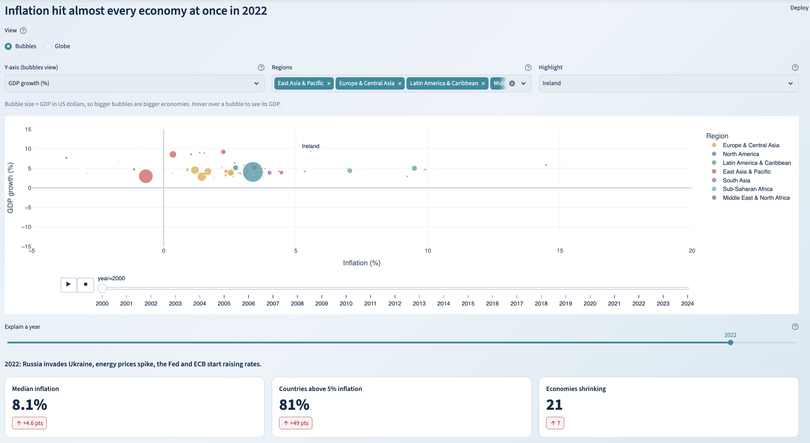
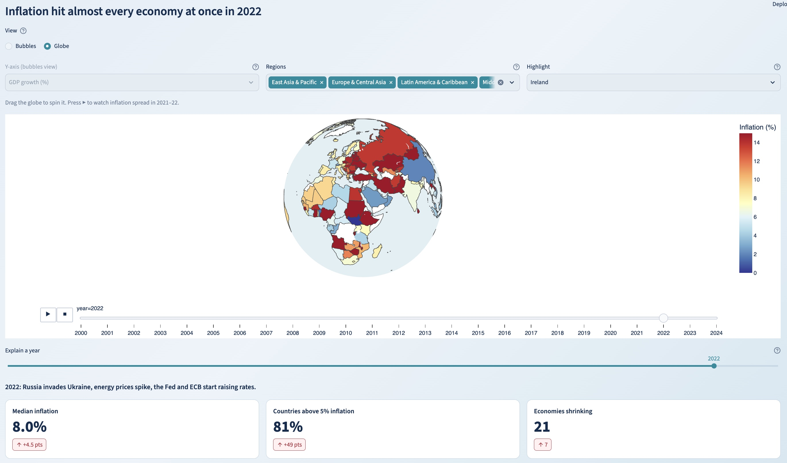
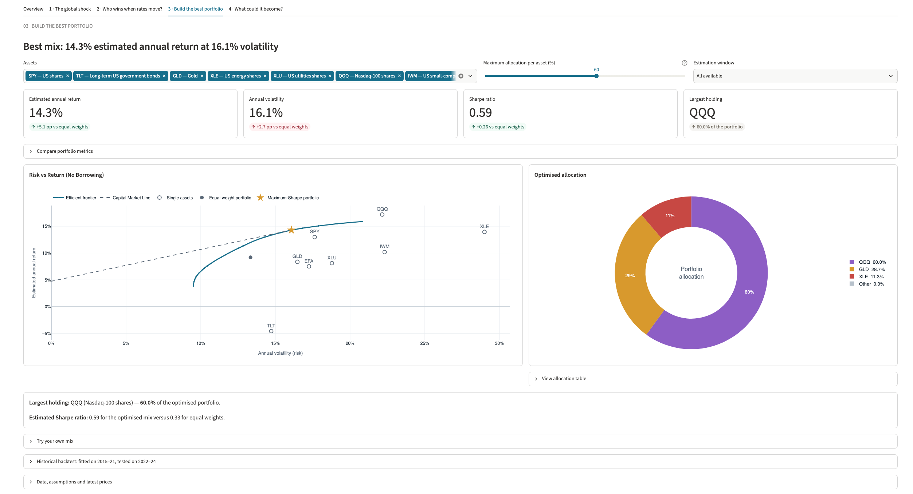

# User Manual
## 1. Getting started
TODO: how to open the dashboard
## 2. Choosing a scenario
TODO: what the scenario switch does
## 3. Panel 1: The global shock

Shows where inflation struck around the world from 2000 to 2024, and how it related to growth, for around 190 countries. This panel shows history, so it does not change with the scenario.

**Controls**

- **View:** switch between **Bubbles** (compare countries) and **Globe** (see where inflation was).
- **Y-axis (bubbles view):** compare inflation with **GDP growth** or with **unemployment**. It is greyed out on the globe, which shows inflation only.
- **Regions:** untick regions to focus on the others.
- **Highlight:** the country named on the chart as it plays (Ireland by default).
- **▶ and the year slider** (under the chart): play the years 2000–2024, or drag to any year.
- **Explain a year:** pick a year to see what happened and its numbers. The play button runs in your browser, so use this slider to update the numbers underneath.

**How to read the bubble chart**

- **Each bubble is a country.** Across: inflation (%). Up: GDP growth (%) or unemployment (%).
- **Bubble size:** the size of the economy (GDP in US dollars). Hover over a bubble to see its GDP.
- **Colour:** the country's region, shown in the legend.
- Countries outside the chart's axes are listed underneath ("Off the chart in 2022: …"), so none are hidden.

**How to read the globe**

- Each country is coloured by its inflation rate, from **blue (low)** to **red (high)**. The scale is fixed at 0–15%, so a colour means the same in every year; anything above 15% shows as the darkest red.
- **Drag the globe** to spin it. Press **▶** to watch inflation spread in 2021–22.

**Explain a year**

- **What happened:** one line on the key event, e.g. "2022: Russia invades Ukraine, energy prices spike, the Fed and ECB start raising rates."
- **The three numbers:** median inflation, the share of countries above 5% inflation, and the number of economies shrinking. The small figure underneath is the change from the year before. **Red means worse** (more inflation, more economies shrinking) and green means better.
- **Correlation:** a sentence giving the Spearman rank correlation (ρ) between inflation and growth (or unemployment) that year. Below 0 means countries with higher inflation tended to grow more slowly. "Statistically significant" means p is below 0.05.
- **Largest bubble:** the biggest economy that year, as a guide to bubble sizes.
- **"Why does Ireland's GDP jump around?"** (shown when Ireland is highlighted): explains why multinationals make Irish GDP swing, and why the CSO's GNI\* gives a truer picture.

**Good to know**

- A year is only shown if at least 80% of countries reported data, so the bubbles don't flicker as countries drop in and out.
- Under the chart, a grey line says when the data was fetched live from the World Bank. If the World Bank is slow or unavailable, the panel uses a saved copy and shows a **yellow notice** with its date.

All values are historical World Bank data, not forecasts.
## 4. Panel 2: Who wins when rates move?
TODO

## 5. Panel 3: Build the best portfolio

Explore how different investments can be combined to balance estimated return and risk. The panel compares an equal-weight portfolio with an optimised portfolio that maximises the estimated Sharpe ratio under your chosen allocation limit.

**Controls**

- **Assets:** choose from SPY, TLT, GLD, XLE, XLU, QQQ, IWM and EFA. At least three assets are required.
- **Maximum allocation per asset:** limits how much the optimiser can put into one asset. Allocations must still total 100%, so selecting fewer assets may require a higher limit.
- **Estimation window:** use all available history or the last 3, 5 or 10 years. The window ends at the latest available price observation.
- **Economic scenario:** the shared scenario supplies the risk-free rate. When Panel 2 supplies sensitivities for every selected asset, Panel 3 also applies an illustrative rate-shock adjustment to estimated returns. The data and assumptions section explains the calculation.

**The headline numbers**

- **Estimated annual return:** an annualised estimate based on historical daily returns, including any scenario adjustment.
- **Annual volatility:** the estimated variability of returns. Higher volatility means greater variation, including potential losses.
- **Sharpe ratio:** estimated return above the risk-free rate, divided by volatility. A higher value indicates more estimated excess return per unit of risk.
- **Largest holding:** the asset receiving the highest allocation in the optimised portfolio.

The comparisons underneath the metrics show differences from an equal-weight portfolio. “pp” means percentage points: moving from 8% to 10% is an increase of 2 percentage points.

Open **Compare portfolio metrics** to see both portfolios together.

**How to read the risk–return chart**

- **Horizontal axis:** annual volatility. Further right means higher estimated risk.
- **Vertical axis:** estimated annual return.
- **Efficient frontier:** portfolios with the lowest estimated volatility for each return target, subject to the selected allocation limit.
- **Gold star:** the optimised maximum-Sharpe portfolio.
- **Grey filled point:** the equal-weight portfolio.
- **Hollow points:** individual assets. These represent investing 100% in one ETF, so they may exceed your allocation limit.
- **Dashed line, labelled Capital Market Line:** illustrates combinations of risk-free cash and the optimised portfolio. It stops at the star because borrowing is excluded. It is an illustrative cash-and-portfolio line rather than an estimate of the economy-wide market portfolio.

Hover over the chart to inspect individual points.

**Optimised allocation**

The doughnut chart shows the optimised holdings. Allocations below 0.5% are grouped into **Other**.

Open **View allocation table** to see every selected asset and its weight. Some selected assets may receive a zero allocation.

**Try your own mix**

Expand **Try your own mix** and enter percentages totalling 100%.

A valid custom portfolio appears as a purple diamond on the risk–return chart, with its estimated return, volatility and Sharpe ratio shown below the inputs.

The maximum-allocation slider constrains the optimiser, not your custom mix. Panel 4 continues to receive the optimised portfolio rather than your custom allocation.

**Historical backtest**

Expand **Historical backtest: fitted on 2015–21, tested on 2022–24**.

The panel estimates portfolio weights using only 2015–2021 data, then evaluates their buy-and-hold performance during 2022–2024. The comparison starts at US$100 at the final available close of 2021.

The chart compares:

- The portfolio optimised using the training period.
- A portfolio initially allocated 60% to SPY and 40% to TLT.
- SPY alone.

The results table reports total return, annualised compound return, annual volatility and maximum drawdown. Maximum drawdown is the largest fall from a previous portfolio-value peak.

This backtest uses your selected assets and allocation limit, but a fixed 3% risk-free rate. It is independent of the current estimation-window selector and scenario adjustments. Holdings are not rebalanced during the test period.

**Using the portfolio in Panel 4**

Open Panel 4 and select **My Panel 3 portfolio** under **Use returns from**.

Panel 4 receives the optimised funds, weights, estimated return, volatility and estimation dates. If Panel 3 cannot produce a valid portfolio, Panel 4 explains that the risk-quiz portfolio is being used instead.

**Data and limitations**

Open **Data, assumptions and latest prices** for the price table, calculation methods and scenario assumptions.

Prices come from Yahoo Finance, with saved CSV data used if downloading fails. Calculations require at least 252 shared daily price observations.

Returns are expressed in USD and exclude trading costs, taxes and currency conversion. Historical estimates, illustrative scenario adjustments and backtest results are not forecasts.

## 6. Panel 4: What could it become?
Shows what someone saving every month could end up with, across 1,000 simulated futures, in today's euros.

**Controls**
- **Monthly (€), Years, Starting amount:** how much you save, for how long, and what you start with.
- **Inflation:** starts at the chosen scenario's rate, or Ireland's latest rate from the World Bank. Drag it to try your own.
- **Savings goal:** a target in today's euros. Set it to 0 to switch it off.
- **Risk quiz:** three questions that pick a mix of shares (SPY) and bonds (TLT): Cautious 30/70, Balanced 60/40 or Adventurous 90/10.
- **Use returns from:** your quiz mix, or the optimal portfolio from Panel 3 (if Panel 3 has built one).
- **Simulation method:** *Real past months (bootstrap)* re-uses real months since 2015 in a random order; *Bell curve* draws returns from a normal distribution with the same average and volatility.

**How to read the chart**
- **Dark band:** the middle half of the 1,000 futures. **Light band:** 90% of them.
- **Solid line:** the middle outcome. **Dashed line:** the money you paid in, in today's euros. **Dotted line:** your goal.
- Hover over any year to see all the values.
- **The four numbers underneath:** bad case (only 1 in 20 futures did worse), middle outcome, good case (only 1 in 20 did better), and the chance of reaching your goal.

**Download my projection (CSV):** saves a year-by-year table of the money paid in and the bad, middle and good outcomes.

All values are a range of possible outcomes, not a forecast.
## 7. When something goes wrong
TODO: messages users might see and what they mean
